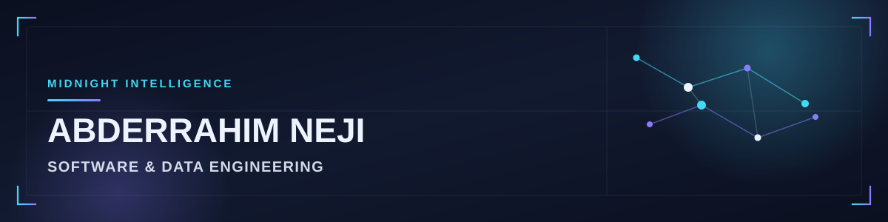

  

# Abderrahim Neji

I work on AI/ML, computer vision, RAG/LLM systems, and backend engineering.

---

## Selected projects

- [ZUPdeCO Assistant](https://github.com/AbderrahimNeji/Assistant_ZUPdeCO) — RAG / AI assistant with retrieval and a chat API.
- [ML-project](https://github.com/AbderrahimNeji/ML-project) — Classification pipeline with tests and CI.
- [OliveGrove IOT](https://github.com/AbderrahimNeji/OliveGrove_IOT) — IoT + ML monitoring for olive groves.
- [FinalProjectDevops](https://github.com/AbderrahimNeji/FinalProjectDevops) — Computer vision / YOLO tooling.

---

## Stack

Python · TypeScript / NestJS · Node · PyTorch / sklearn · YOLO / OpenCV · PostgreSQL / MongoDB · Docker / CI

---

## Contact

  <a href="https://abderrahimneji.github.io/abderrahim-neji-portfolio/">Portfolio</a>
  ·
  <a href="https://www.linkedin.com/in/abderrahim-neji">LinkedIn</a>
  ·
  <a href="https://github.com/AbderrahimNeji">GitHub</a>

